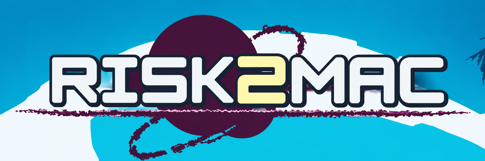

# Risk2Mac



[Русская инструкция](README.ru.md)

Risk2Mac assembles a local macOS build of Risk of Rain 2 from a matching Windows installation and privately supplied compatibility inputs. It selects the native `arm64` or `x86_64` slices of Unity Mono and Wwise, copies the original data, adjusts Addressables paths, and installs the locally prepared Metal assets. It compiles the compatibility helpers, applies the managed patches for storage and input, and signs the resulting `.app` locally. The game stores mutable settings outside its signed application bundle.

**Build status.** This recipe targets the specific 1.5.0 data profile in the manifests. It requires the private preparation described below. The public recipe cannot recreate all Metal bundles, the recovered startup data or the early managed patches from a stock Windows install. It builds the existing solo port. Intel packaging is supported, while gameplay on Intel hardware still needs verification.

## Performance

Reported gameplay FPS on **Verdant Falls** with the settings below.

| Resolution | MacBook Air 2020 (M1, 8 GB) | MacBook Pro 16-inch (M5 Pro, 24 GB) |
| --- | --- | --- |
| 3456 × 2168 | Not supported | 140–150 FPS |
| 2560 × 1600 | 45–48 FPS | 180–200 FPS |
| 1920 × 1200 | Not supported | 280–300 FPS |
| 1440 × 900 | 90–105 FPS | Coming soon |
| 1280 × 800 | 100–120 FPS | Coming soon |

<details>
<summary>Graphics settings used for the measurements</summary>

| Setting | Value |
| --- | --- |
| Shadow Type | Soft |
| Shadow Resolution | Medium |
| Shadow Cascades | 2 |
| Shadow Distance | High |
| Anti-Aliasing | Off |
| Texture Resolution | Full |
| VFX Culling Bias | Ultra |
| LOD Bias | Ultra |
| LOD Reduction | Off |
| Bloom | On |
| SSAO | On |
| Foliage Wind | On |
| Sobel Lighting | On |
| Corpse Clean-up | Hidden |
| Max Corpses | 25 |

</details>

## Requirements

- A Mac running a [macOS version supported by the .NET 8 SDK](https://learn.microsoft.com/en-us/dotnet/core/install/macos), [Xcode Command Line Tools](https://developer.apple.com/documentation/xcode/installing-the-command-line-tools), Python 3.9+ and at least 10 GB of free working space. The generated app targets macOS 11 or later with Metal. Use APFS or Mac OS Extended for the output and tool cache. The repository and private inputs can live on ExFAT.
- Your own Windows game installation matching the pinned input hashes. Use the folder containing `Risk of Rain 2_Data`. The Windows executable is optional. The matching executable supplies the icon locally and the builder never executes it.
- Unity **2023.1.0f1** macOS Mono Build Support and Wwise **2024.1.18** Unity Integration for macOS, obtained through the vendors. See [Native inputs](native/README.md) for the exact paths and the alternative private native export.
- The compatible private game assets and managed assemblies listed in [assets.json](manifests/assets.json) and [inputs.json](managed/inputs.json). A newer Windows version or different files with the same version label can fail validation.

The builder uses an installed .NET 8 SDK if available. Otherwise it downloads [Microsoft's .NET 8.0.427 SDK](https://dotnet.microsoft.com/en-us/download/dotnet/8.0) for the host CPU and verifies its SHA-512. The managed build restores [Mono.Cecil 0.11.6](https://www.nuget.org/packages/Mono.Cecil/0.11.6) from NuGet. Keep the SDK and NuGet cache outside the repository.

## Prepare private inputs

Keep `PRIVATE` in a separate directory outside the repository. The manifests specify the exact filenames and hashes. The `kind: private` asset entries go under `PRIVATE/assets/Contents/Resources/Data/`. Converted bank entries go there too if using the preconverted banks. Entries marked `private`, `storage` and `wwise` in the managed manifest go under `PRIVATE/managed/`. `storage` entries take the **input** hash from the manifest, since the builder applies the storage patch. For Wwise, the supported official source pair can replace the private API assembly. See [Managed inputs](managed/README.md) and [Asset inputs](docs/assets.md) for the exact alternatives.

If you already have the matching reviewed Mac build and its pre-storage `RoR2.dll` and `ModLoader.dll` backups, the following commands prepare an owner-only local kit. They export just the files the recipe needs. `PRE_STORAGE` points to the folder with those two backups. Use a new `PRIVATE` directory and start these commands from the Risk2Mac repository.

```bash
PORT="/Applications/Risk of Rain 2.app"
PRE_STORAGE="/path/to/pre-storage-backup"
PRIVATE="$HOME/Risk2Mac-Private/Prerequisites"

python3 scripts/build-assets.py --export-private "$PORT" --private "$PRIVATE" --include-banks
python3 scripts/build-managed-inputs.py --port-app "$PORT" --pre-storage "$PRE_STORAGE" --private "$PRIVATE"
bash scripts/build-native-inputs.sh --port-app "$PORT" --private "$PRIVATE"
```

If starting with the Windows game for the first time, you need to prepare the missing compatible asset and managed inputs privately before this recipe can build the port. The manifests let you verify them. The repository provides no download for those inputs.

## Build

Install Command Line Tools with `xcode-select --install` if needed. Open Terminal, enter the Risk2Mac folder and set the three paths to your actual locations.

```bash
GAME="/path/to/Windows/Risk of Rain 2"
PRIVATE="/path/to/Prerequisites"
OUTPUT="$HOME/Risk2Mac Builds/Risk of Rain 2.app"

python3 scripts/build-assets.py --game "$GAME" --private "$PRIVATE" --check
python3 scripts/build-managed.py --game "$GAME" --private "$PRIVATE" --check-inputs
bash build.sh --game "$GAME" --private "$PRIVATE" --output "$OUTPUT"
```

For an ExFAT SSD, you can keep the output on the same drive using an APFS disk image. Create a new image and mount it, then set `OUTPUT` and the optional `--tools` cache path inside the mounted volume.

```bash
hdiutil create -size 24g -type SPARSEBUNDLE -fs APFS -volname Risk2Mac-Build \
  "/Volumes/SSD/Risk2Mac Build.sparsebundle"
hdiutil attach "/Volumes/SSD/Risk2Mac Build.sparsebundle"
bash build.sh --game "$GAME" --private "$PRIVATE" \
  --output "/Volumes/Risk2Mac-Build/Risk of Rain 2.app" \
  --tools "/Volumes/Risk2Mac-Build/tools"
```

The output path must be new. The build selects the architecture automatically. For explicit packaging, pass `--arch arm64` or `--arch x86_64`. `--dotnet /path/to/dotnet` selects an installed SDK. `--wwiser /path/to/wwiser` enables local bank conversion. `--unity-support` and `--wwise` select the official native inputs from non-default locations.

Open the resulting `.app` in Finder. On startup, the app writes Unity and launcher logs to `~/Library/Logs/Risk Of Rain 2/`. The `Latest-Unity.log` and `Latest-Launcher.log` links point to the latest run. Configuration, mod lists, run reports and generated caches use `~/Library/Application Support/com.Hopoo-Games--LLC.Risk-of-Rain-2/ARM64Solo/Runtime/`.
