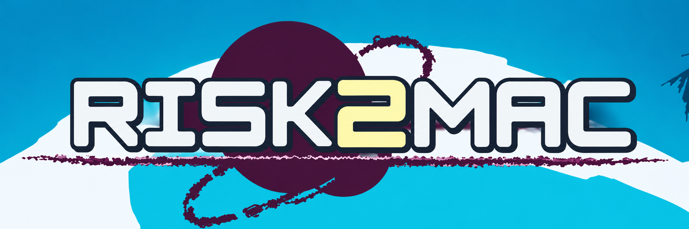
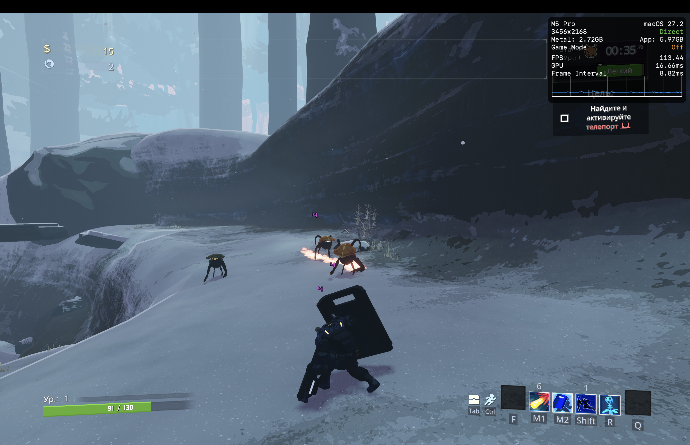

# Risk2Mac



[Русская инструкция](README.ru.md)

Risk2Mac builds a native macOS app from your Windows installation of Risk of Rain 2 and the official Unity and Wwise SDKs. It selects the `arm64` or `x86_64` Unity Mono and Wwise binaries, adapts the original game data and shaders for Metal, compiles the port's compatibility code and signs the resulting `.app` locally. Saves and settings live outside the signed app bundle.

This recipe targets the Windows Steam release **1.5.0#1224** (build **25921972**). The builder verifies the game against the [asset manifest](manifests/assets.json) and [managed input manifest](managed/inputs.json). Runtime checks have been performed on Apple Silicon. The builder can also target Intel, where gameplay still needs hardware testing.

## Steam integration

Steam mode uses the installed Steam client for game presence, cloud profiles and DLC ownership checks. To play an expansion, its content must be present in the build and Steam must verify that your account owns it. When Steam is unavailable, the game falls back to base-game play with a separate local profile. [Steam setup and multiplayer limitations](docs/steam.md)

## Performance

Reported gameplay FPS on **Verdant Falls** with the settings below.

| Resolution | MacBook Air 2020 (M1, 8 GB) | MacBook Pro 16-inch (M5 Pro, 24 GB) |
| --- | --- | --- |
| 3456 × 2168 | Not supported | 140–150 FPS |
| 2560 × 1600 | 45–48 FPS | 180–200 FPS |
| 1920 × 1200 | Not supported | 280–300 FPS |
| 1440 × 900 | 90–105 FPS | Not supported |
| 1280 × 800 | 100–120 FPS | Not supported |

<details>
<summary>Graphics settings used for the measurements</summary>

| Setting | Value |
| --- | --- |
| Shadow Type | Soft |
| Shadow Resolution | Medium |
| Shadow Cascades | 2 |
| Shadow Distance | High |
| Anti-Aliasing | Off |
| Texture Resolution | Full |
| VFX Culling Bias | Ultra |
| LOD Bias | Ultra |
| LOD Reduction | Off |
| Bloom | On |
| SSAO | On |
| Foliage Wind | On |
| Sobel Lighting | On |
| Corpse Clean-up | Hidden |
| Max Corpses | 25 |

</details>



*Gameplay on Siphoned Forest.*

## Requirements

- **Game files.** Copy your Windows installation of Risk of Rain 2 to a location your Mac can read. Select the folder containing `Risk of Rain 2.exe`, `UnityPlayer.dll` and `Risk of Rain 2_Data`, including its startup files, `Managed` and `StreamingAssets`. The builder checks the matched 1.5.0 files and uses the Windows executable to extract the app icon.
- **Mac build tools.** Install Xcode Command Line Tools with `xcode-select --install` if needed. Use Python 3.9+ and a macOS version supported by the build SDKs. The generated app targets macOS 11 or later with Metal. Use APFS or Mac OS Extended for the output and tool cache. [Apple Command Line Tools](https://developer.apple.com/documentation/xcode/installing-the-command-line-tools) · [.NET macOS requirements](https://learn.microsoft.com/en-us/dotnet/core/install/macos)
- **Unity.** Sign in to Unity Hub, install the full **Unity Editor 2023.1.0f1** with Mac Mono Build Support, and activate your Editor license. The build uses it to regenerate Unity startup data and Metal resources. For a custom Editor location, select it in Builder or pass `--unity-editor`. If its Mac support DLLs differ from the supported runtime, the builder can fetch the pinned Unity module separately. [Unity Hub setup](https://docs.unity.com/en-us/hub/install-hub-win-mac) · [Unity 2023.1.0f1](https://unity.com/releases/editor/whats-new/2023.1.0f1)
- **Wwise.** Sign in to Audiokinetic Launcher. Under **Unity → Offline Integration Files**, export **Wwise Unity Integration 2024.1.18** for both macOS and Windows into Downloads. The builder finds and verifies `Unity.Mac.tar.xz` and `Unity.Windows.tar.xz` there. The builder also accepts a custom export folder containing both archives via **Advanced inputs** or `--wwise`. [Wwise setup and custom SDK paths](native/README.md)

The first build needs an internet connection for tools and source packages. The builder uses an installed .NET 8 SDK or downloads and verifies Microsoft's SDK for your Mac. It generates the compatible game data and managed assemblies in the build directory from your game files and the vendor tools. Keep the tool cache outside the repository and game folder.

### Get the supported Windows files on a Mac

If your Windows Steam copy is build **25921972**, copy its `steamapps/common/Risk of Rain 2` folder to your Mac and select it in Builder. You can also download those files directly to a Mac from Windows depot `632361`, manifest `7949517344059620660`. Risk2Mac checks the game assembly and its matching asset catalog before preparing the SDKs. For the earlier October 8 depot, use [Builder 0.1.11](https://github.com/TsiFroviK/Risk2Mac/releases/tag/builder-v0.1.11).

1. Sign in to the Steam account that owns the game and open `steam://open/console` on the Mac.
2. If you previously downloaded this depot, move that download's `depot_632361` folder aside so Steam starts with an empty destination. Keep the installed game and its saves in place.
3. Enter the following command in Steam's **Console** tab and wait for **Depot download complete**.

   ```text
   download_depot 632360 632361 7949517344059620660
   ```

4. Select the completed `depot_632361` directory in Builder or pass it to `--game`. Steam prints its full path. One macOS client location is `~/Library/Application Support/Steam/Steam.AppBundle/Steam/Contents/MacOS/steamapps/content/app_632360/depot_632361`. You can use the fresh download directly without launching the game on Windows.

## Build

### Build with the graphical app

1. Open the **Risk2Mac Builder** universal DMG and move the Builder into Applications. [Releases](https://github.com/TsiFroviK/Risk2Mac/releases)
2. Select your **Windows game folder**. Use **Set up Unity** and **Set up Wwise** to open the vendors’ setup and sign-in screens if needed. For a nonstandard SDK location, select it under **Advanced inputs**.
3. Leave **Steam integration** on to build inside a registered Steam library. For a standalone build, turn it off and select an **Output folder**.
4. Click **Build**. When it finishes, use **Show in Finder** to locate `Risk of Rain 2.app` or launch it from the Steam shortcut. **Show log** opens the build log.

The Builder checks for its own updates automatically. Choose **Update** to download the DMG, install the new Builder in its current folder, and restart it. **Later** postpones the update. **Don't remind me** turns off automatic checks, which you can re-enable in **Settings**.

Steam mode adds **Risk of Rain 2 (Risk2Mac)** as a separate local shortcut. Close Steam before the build finishes for automatic registration, or close it afterward and use **Add to Steam** in the Builder. [Steam setup](docs/steam.md)

### Build from the command line

Clone Risk2Mac and open its folder in Terminal. The setup commands open the vendors’ installation and sign-in screens. Complete the SDK steps above before starting a build.

```bash
git clone https://github.com/TsiFroviK/Risk2Mac.git
cd Risk2Mac
bash build.sh --setup unity
bash build.sh --setup wwise
```

For a standalone app with a local profile, set the game path and a new output path.

```bash
GAME="/path/to/Windows/Risk of Rain 2"
OUTPUT="$HOME/Risk2Mac Builds/Risk of Rain 2.app"
bash build.sh --game "$GAME" --output "$OUTPUT"
```

For Steam, use the same game path. The builder chooses the output inside a registered Steam library. Use `--steam-library "/path/to/SteamLibrary"` to select a registered library explicitly.

```bash
bash build.sh --game "$GAME" --steam
```

### Advanced options

For an ExFAT SSD, you can keep the output on the same drive using an APFS disk image. Create a new image and mount it, then set `OUTPUT` and the optional `--tools` cache path inside the mounted volume.

```bash
hdiutil create -size 24g -type SPARSEBUNDLE -fs APFS -volname Risk2Mac-Build \
  "/Volumes/SSD/Risk2Mac Build.sparsebundle"
hdiutil attach "/Volumes/SSD/Risk2Mac Build.sparsebundle"
bash build.sh --game "$GAME" \
  --output "/Volumes/Risk2Mac-Build/Risk of Rain 2.app" \
  --tools "/Volumes/Risk2Mac-Build/tools"
```

The output path must be new. The build selects the architecture automatically. For explicit packaging, pass `--arch arm64` or `--arch x86_64`. `--dotnet /path/to/dotnet` selects an installed SDK. `--wwiser /path/to/wwiser` selects a local parser checkout for bank conversion. Use `--unity-editor`, `--unity-support` and `--wwise` for official components in custom locations.

The CLI also accepts `--private /path/to/inputs` if you already have compatible outputs from a previous local build. [Asset inputs](docs/assets.md) · [Managed inputs](managed/README.md) · [Native inputs](native/README.md)

Open the resulting `.app` in Finder. On startup, the app writes Unity and launcher logs to `~/Library/Logs/Risk Of Rain 2/`. The `Latest-Unity.log` and `Latest-Launcher.log` links point to the latest run. Configuration, mod lists, run reports and generated caches use `~/Library/Application Support/com.Hopoo-Games--LLC.Risk-of-Rain-2/ARM64Solo/Runtime/`.

If loading repeatedly stops after shader compilation, try the [single-threaded launch option](docs/steam.md#if-loading-stops-before-the-menu).
