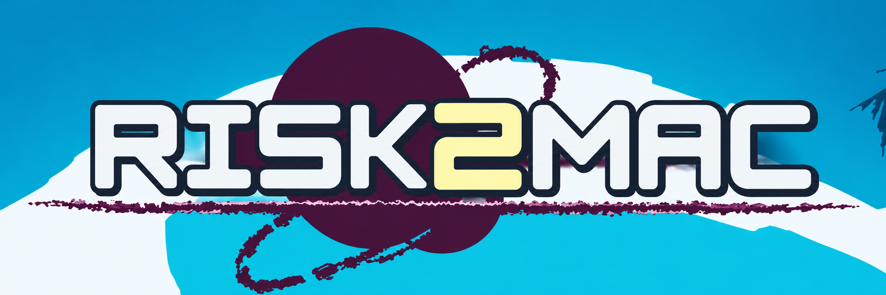
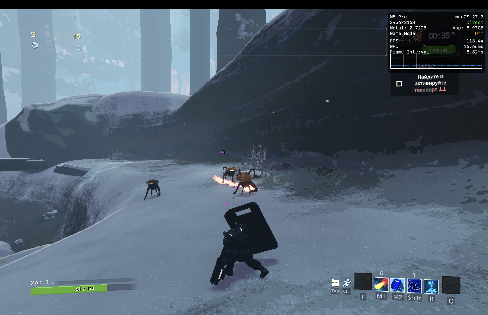

# Risk2Mac



[English instructions](README.md)

Risk2Mac собирает локальную версию Risk of Rain 2 для macOS из подходящей Windows-установки и подготовленных на вашем компьютере компонентов совместимости. Скрипт выбирает нативные части Unity Mono и Wwise для `arm64` или `x86_64`, копирует данные игры, исправляет пути Addressables и подключает подготовленные Metal-ресурсы. Он компилирует вспомогательный код, применяет исправления хранения данных и управления и подписывает готовый `.app` локально. Изменяемые настройки хранятся вне подписанного приложения.

**Состояние сборщика.** Инструкция рассчитана на конкретный набор файлов версии 1.5.0, зафиксированный в манифестах. Для сборки нужны локальные входы, перечисленные ниже. Публичный рецепт пока не восстанавливает из Windows-установки все Metal-бандлы, данные запуска Unity и ранние исправления управляемого кода. Он собирает существующий одиночный порт. Выбор сборки для Intel предусмотрен, игровой запуск на Intel ещё предстоит проверить.

## Производительность

Частота кадров в игре на локации **«Зелёные Водопады»** с настройками ниже.

| Разрешение | MacBook Air 2020 (M1, 8 ГБ) | MacBook Pro 16″ (M5 Pro, 24 ГБ) |
| --- | --- | --- |
| 3456 × 2168 | Не поддерживается | 140–150 FPS |
| 2560 × 1600 | 45–48 FPS | 180–200 FPS |
| 1920 × 1200 | Не поддерживается | 280–300 FPS |
| 1440 × 900 | 90–105 FPS | Не поддерживается |
| 1280 × 800 | 100–120 FPS | Не поддерживается |

<details>
<summary>Настройки графики для замеров</summary>

| Настройка | Значение |
| --- | --- |
| Тип теней | Мягкие |
| Разрешение теней | Среднее |
| Теневые каскады | 2 |
| Расстояние отображения теней | Высокое |
| Сглаживание | Выкл. |
| Разрешение текстур | Полное |
| Замещение ошибок VFX | Ультра |
| Баланс уровня детализации | Ультра |
| Снижение уровня детализации | Выкл. |
| Свечение | Вкл. |
| Окружающее затенение (SSAO) | Вкл. |
| Анимация листвы | Вкл. |
| Фильтр Собеля | Вкл. |
| Расчистка трупов | Вне поля зрения |
| Макс. трупов | 25 |

</details>



*Геймплей на карте «Выкаченный Лес».*

## Что понадобится

- Mac с [версией macOS, поддерживаемой .NET 8 SDK](https://learn.microsoft.com/en-us/dotnet/core/install/macos), [Xcode Command Line Tools](https://developer.apple.com/documentation/xcode/installing-the-command-line-tools), Python 3.9+ и не менее 10 ГБ для сборки. Готовое приложение нацелено на macOS 11 или новее с Metal. Для результата и кэша используй APFS или Mac OS Extended. Репозиторий и локальные входы можно хранить на ExFAT.
- Своя Windows-установка игры с файлами, совпадающими по контрольным суммам. Нужна папка, в которой лежит `Risk of Rain 2_Data`. Windows `.exe` необязателен. Если он совпадает с проверенной версией, скрипт извлечёт из него иконку без запуска программы.
- Unity **2023.1.0f1** с macOS Mono Build Support и Wwise **2024.1.18** Unity Integration для macOS, полученные у разработчиков. Точные пути и способ подготовки из локальной копии описаны в [инструкции по нативным компонентам](native/README.ru.md).
- Локальные ресурсы и сборки из манифестов [assets.json](manifests/assets.json) и [inputs.json](managed/inputs.json). Контрольные суммы важнее надписи `1.5.0`, поскольку набор файлов может отличаться.

Скрипт использует установленный .NET 8 SDK. Если его нет, он скачает [официальный .NET SDK 8.0.427](https://dotnet.microsoft.com/en-us/download/dotnet/8.0) для процессора Mac и проверит SHA-512. Этап управляемого кода получит [Mono.Cecil 0.11.6](https://www.nuget.org/packages/Mono.Cecil/0.11.6) через NuGet. Кэши инструментов храни вне репозитория.

## Подготовка локальных входов

Создай отдельную папку `PRIVATE` вне репозитория. В манифестах перечислены имена файлов и контрольные суммы. Строки `kind: private` из манифеста ресурсов размещаются в `PRIVATE/assets/Contents/Resources/Data/` по указанным путям. Туда же помещаются предварительно конвертированные звуковые банки, если выбран этот способ. Строки `private`, `storage` и `wwise` из манифеста сборок размещаются в `PRIVATE/managed/`. Для `storage` требуются файлы с **входной** контрольной суммой, поскольку исправление будет применено при сборке. Вместо готового Wwise API можно использовать пару официальных исходных файлов. Подробности есть в [инструкции по сборкам](managed/README.ru.md) и [инструкции по ресурсам](docs/assets.ru.md).

Если у тебя уже есть проверенная версия порта и копии `RoR2.dll` и `ModLoader.dll` до исправления хранения данных, извлеки необходимые компоненты командами ниже. В `PRE_STORAGE` укажи папку с этими двумя резервными файлами. Выполняй команды из папки Risk2Mac и используй новый каталог `PRIVATE`.

```bash
PORT="/Applications/Risk of Rain 2.app"
PRE_STORAGE="/путь/к/резервной-копии"
PRIVATE="$HOME/Risk2Mac-Private/Prerequisites"

python3 scripts/build-assets.py --export-private "$PORT" --private "$PRIVATE" --include-banks
python3 scripts/build-managed-inputs.py --port-app "$PORT" --pre-storage "$PRE_STORAGE" --private "$PRIVATE"
bash scripts/build-native-inputs.sh --port-app "$PORT" --private "$PRIVATE"
```

Для первой сборки с одной Windows-установкой сначала нужно самостоятельно подготовить недостающие совместимые ресурсы и сборки. Их можно сверить по манифестам. Публичной загрузки этих файлов в проекте нет.

## Сборка

При необходимости установи Command Line Tools командой `xcode-select --install`. В Терминале перейди в папку Risk2Mac и подставь свои пути.

```bash
GAME="/путь/к/Windows/Risk of Rain 2"
PRIVATE="/путь/к/Prerequisites"
OUTPUT="$HOME/Risk2Mac Builds/Risk of Rain 2.app"

python3 scripts/build-assets.py --game "$GAME" --private "$PRIVATE" --check
python3 scripts/build-managed.py --game "$GAME" --private "$PRIVATE" --check-inputs
bash build.sh --game "$GAME" --private "$PRIVATE" --output "$OUTPUT"
```

Если SSD отформатирован в ExFAT, результат можно хранить на том же диске внутри подключённого образа APFS. Создай новый образ и используй его для результата и кэша.

```bash
hdiutil create -size 24g -type SPARSEBUNDLE -fs APFS -volname Risk2Mac-Build \
  "/Volumes/SSD/Risk2Mac Build.sparsebundle"
hdiutil attach "/Volumes/SSD/Risk2Mac Build.sparsebundle"
bash build.sh --game "$GAME" --private "$PRIVATE" \
  --output "/Volumes/Risk2Mac-Build/Risk of Rain 2.app" \
  --tools "/Volumes/Risk2Mac-Build/tools"
```

Укажи новый путь для `.app`. По умолчанию скрипт выбирает архитектуру самого Mac. Для явного выбора используй `--arch arm64` или `--arch x86_64`. Параметр `--dotnet /путь/к/dotnet` указывает установленный SDK. `--wwiser /путь/к/wwiser` включает локальное преобразование звуковых банков. Параметры `--unity-support` и `--wwise` позволяют указать нестандартные пути к официальным компонентам.

Открой готовый `.app` в Finder. Логи Unity и запуска находятся в `~/Library/Logs/Risk Of Rain 2/`. Ссылки `Latest-Unity.log` и `Latest-Launcher.log` ведут на последний запуск. Настройки, список модов, отчёты и кэш хранятся в `~/Library/Application Support/com.Hopoo-Games--LLC.Risk-of-Rain-2/ARM64Solo/Runtime/`.