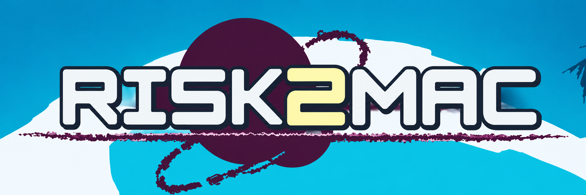
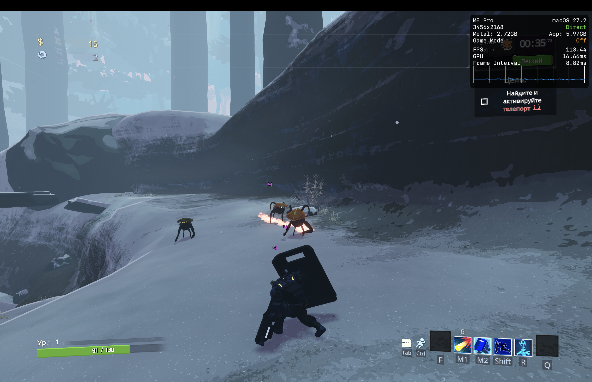

# Risk2Mac



[English instructions](README.md)

Risk2Mac собирает нативное приложение для macOS из твоей Windows-установки Risk of Rain 2 и официальных SDK Unity и Wwise. Сборщик выбирает библиотеки Unity Mono и Wwise для `arm64` или `x86_64`, адаптирует данные игры и шейдеры под Metal, компилирует код совместимости и локально подписывает готовый `.app`. Сохранения и настройки хранятся отдельно от подписанного приложения.

Сборщик рассчитан на Windows-версию **1.5.0#1224** из Steam (сборка **25921972**). Он сверяет игру с [манифестом ресурсов](manifests/assets.json) и [манифестом библиотек](managed/inputs.json). Запуск проверялся на Apple Silicon. Сборщик также поддерживает выбор архитектуры Intel, где игру ещё предстоит проверить на соответствующем Mac.

## Интеграция со Steam

В режиме Steam установленный клиент отвечает за статус игры, облачные профили и проверку владения DLC. Чтобы запустить дополнение, его файлы должны быть в сборке, а Steam должен подтвердить покупку на твоём аккаунте. Если Steam недоступен, игра переключается на базовую версию с отдельным локальным профилем. [Настройка Steam и ограничения сетевой игры](docs/steam.ru.md)

## Производительность

Частоту кадров измеряли на локации **«Зелёные Водопады»** с настройками ниже, до перехода на прямой рендеринг Metal на Apple Silicon в Builder 0.1.13.

| Разрешение | MacBook Air 2020 (M1, 8 ГБ) | MacBook Pro 16″ (M5 Pro, 24 ГБ) |
| --- | --- | --- |
| 3456 × 2168 | Не поддерживается | 140–150 FPS |
| 2560 × 1600 | 45–48 FPS | 180–200 FPS |
| 1920 × 1200 | Не поддерживается | 280–300 FPS |
| 1440 × 900 | 90–105 FPS | Не поддерживается |
| 1280 × 800 | 100–120 FPS | Не поддерживается |

<details>
<summary>Настройки графики для замеров</summary>

| Настройка | Значение |
| --- | --- |
| Тип теней | Мягкие |
| Разрешение теней | Среднее |
| Теневые каскады | 2 |
| Расстояние отображения теней | Высокое |
| Сглаживание | Выкл. |
| Разрешение текстур | Полное |
| Замещение ошибок VFX | Ультра |
| Баланс уровня детализации | Ультра |
| Снижение уровня детализации | Выкл. |
| Свечение | Вкл. |
| Окружающее затенение (SSAO) | Вкл. |
| Анимация листвы | Вкл. |
| Фильтр Собеля | Вкл. |
| Расчистка трупов | Вне поля зрения |
| Макс. трупов | 25 |

</details>



*Геймплей на карте «Выкаченный Лес».*

## Что понадобится

- **Файлы игры.** Скопируй свою Windows-установку Risk of Rain 2 туда, где Mac сможет её прочитать. Выбери папку с `Risk of Rain 2.exe`, `UnityPlayer.dll` и каталогом `Risk of Rain 2_Data`, в котором есть файлы запуска, `Managed` и `StreamingAssets`. Сборщик сверяет файлы версии 1.5.0 и извлекает иконку приложения из Windows-исполняемого файла.
- **Инструменты для Mac.** При необходимости установи Xcode Command Line Tools командой `xcode-select --install`. Нужны Python 3.9+ и версия macOS, поддерживаемая SDK для сборки. Готовое приложение нацелено на macOS 11 или новее с Metal. Для результата и кэша используй APFS или Mac OS Extended. [Инструменты командной строки Apple](https://developer.apple.com/documentation/xcode/installing-the-command-line-tools) · [Требования .NET к macOS](https://learn.microsoft.com/en-us/dotnet/core/install/macos)
- **Unity.** Войди в Unity Hub, установи полный **Unity Editor 2023.1.0f1** с Mac Mono Build Support и активируй лицензию редактора. Сборщик использует редактор для подготовки данных запуска Unity и ресурсов Metal. Редактор в нестандартной папке можно выбрать в Builder или передать через `--unity-editor`. Если его Mac-библиотеки отличаются от поддерживаемых, сборщик может скачать подходящий модуль Unity отдельно. [Настройка Unity Hub](https://docs.unity.com/en-us/hub/install-hub-win-mac) · [Unity 2023.1.0f1](https://unity.com/releases/editor/whats-new/2023.1.0f1)
- **Wwise.** Войди в Audiokinetic Launcher. В разделе **Unity → Offline Integration Files** выгрузи **Wwise Unity Integration 2024.1.18** для macOS и Windows в «Загрузки». Сборщик найдёт там `Unity.Mac.tar.xz` и `Unity.Windows.tar.xz` и проверит их. Папку с обоими архивами можно выбрать в **«Дополнительных параметрах»** или передать через `--wwise`. [Настройка Wwise и нестандартные пути к SDK](native/README.ru.md)

Для первой сборки нужен интернет, чтобы скачать инструменты и исходные пакеты. Сборщик использует установленный .NET 8 SDK или скачивает и проверяет SDK Microsoft для твоего Mac. Данные игры и управляемые сборки для macOS создаются во время сборки из твоих файлов и инструментов разработчиков SDK. Храни кэш вне репозитория и папки игры.

### Как получить нужные файлы Windows на Mac

Если в Steam на Windows установлена сборка **25921972**, скопируй папку `steamapps/common/Risk of Rain 2` на Mac и выбери её в Builder. Эти же файлы можно скачать сразу на Mac из Windows-депо `632361` с манифестом `7949517344059620660`. Перед подготовкой SDK Risk2Mac сверяет версию игровой библиотеки и каталога ресурсов. Для прежнего депо от 8 октября доступен [Builder 0.1.11](https://github.com/TsiFroviK/Risk2Mac/releases/tag/builder-v0.1.11).

1. Войди в Steam под аккаунтом, на котором куплена игра, и открой на Mac `steam://open/console`.
2. Если этот депо уже скачивался, перемести прежнюю папку загрузки `depot_632361` в другое место, чтобы Steam скачал файлы в пустую папку. Установленную игру и сохранения оставь на месте.
3. Во вкладке **Console** введи команду и дождись сообщения **Depot download complete**.

   ```text
   download_depot 632360 632361 7949517344059620660
   ```

4. Выбери скачанную папку `depot_632361` в Builder или передай её через `--game`. Steam покажет полный путь. На macOS он может выглядеть так — `~/Library/Application Support/Steam/Steam.AppBundle/Steam/Contents/MacOS/steamapps/content/app_632360/depot_632361`. Предварительно запускать игру в Windows не требуется.

## Сборка

### Сборка через приложение

1. Открой универсальный DMG **Risk2Mac Builder** и перенеси сборщик в «Программы». [Releases](https://github.com/TsiFroviK/Risk2Mac/releases)
2. Выбери **«Папка игры для Windows»**. При необходимости кнопки **«Настроить Unity»** и **«Настроить Wwise»** откроют установку и вход у разработчиков SDK. Нестандартные пути к SDK укажи в **«Дополнительных параметрах»**.
3. Оставь **«Интеграция Steam»** включённой для сборки в зарегистрированную библиотеку Steam. Для самостоятельной сборки выключи её и выбери **«Папка для готовой игры»**.
4. Нажми **«Собрать»**. После сборки выбери **«Показать в Finder»**, чтобы найти `Risk of Rain 2.app`, или открой игру через ярлык Steam. Кнопка **«Открыть журнал»** показывает журнал сборки.

Сборщик автоматически проверяет собственные обновления. Кнопка **«Обновить»** скачивает DMG, устанавливает новую версию сборщика в ту же папку и перезапускает его. **«Позже»** откладывает обновление, а **«Не напоминать»** выключает автопроверку. Включить её снова можно в **«Настройках»**.

В режиме Steam сборщик добавляет отдельный локальный ярлык **Risk of Rain 2 (Risk2Mac)**. Для автоматической регистрации закрой Steam до завершения сборки. Если Steam остался запущен, закрой его после сборки и нажми **«Добавить в Steam»**. [Настройка Steam](docs/steam.ru.md)

### Сборка из Терминала

Склонируй Risk2Mac и открой его папку в Терминале. Команды настройки откроют установку и вход у разработчиков SDK. Выполни шаги подготовки SDK выше перед запуском сборки.

```bash
git clone https://github.com/TsiFroviK/Risk2Mac.git
cd Risk2Mac
bash build.sh --setup unity
bash build.sh --setup wwise
```

Для самостоятельного приложения с локальным профилем укажи папку игры и новый путь для результата.

```bash
GAME="/путь/к/Windows/Risk of Rain 2"
OUTPUT="$HOME/Risk2Mac Builds/Risk of Rain 2.app"
bash build.sh --game "$GAME" --output "$OUTPUT"
```

Для Steam укажи ту же папку игры. Сборщик выберет путь внутри зарегистрированной библиотеки Steam. Чтобы явно выбрать зарегистрированную библиотеку, используй `--steam-library "/путь/к/SteamLibrary"`.

```bash
bash build.sh --game "$GAME" --steam
```

### Дополнительные параметры

Если SSD отформатирован в ExFAT, результат можно хранить на том же диске внутри подключённого образа APFS. Создай новый образ и используй его для результата и кэша.

```bash
hdiutil create -size 24g -type SPARSEBUNDLE -fs APFS -volname Risk2Mac-Build \
  "/Volumes/SSD/Risk2Mac Build.sparsebundle"
hdiutil attach "/Volumes/SSD/Risk2Mac Build.sparsebundle"
bash build.sh --game "$GAME" \
  --output "/Volumes/Risk2Mac-Build/Risk of Rain 2.app" \
  --tools "/Volumes/Risk2Mac-Build/tools"
```

Укажи новый путь для `.app`. По умолчанию скрипт выбирает архитектуру самого Mac. Для явного выбора используй `--arch arm64` или `--arch x86_64`. Параметр `--dotnet /путь/к/dotnet` указывает установленный SDK. `--wwiser /путь/к/wwiser` выбирает локальную копию парсера для преобразования банков. Параметры `--unity-editor`, `--unity-support` и `--wwise` позволяют указать нестандартные пути к официальным компонентам.

Если у тебя уже есть совместимые файлы из предыдущей локальной сборки, их можно передать через `--private /путь/к/файлам`. [Ресурсы](docs/assets.ru.md) · [Управляемые сборки](managed/README.ru.md) · [Нативные компоненты](native/README.ru.md)

Открой готовый `.app` в Finder. Логи Unity и запуска находятся в `~/Library/Logs/Risk Of Rain 2/`. Ссылки `Latest-Unity.log` и `Latest-Launcher.log` ведут на последний запуск. Настройки, список модов, отчёты и кэш хранятся в `~/Library/Application Support/com.Hopoo-Games--LLC.Risk-of-Rain-2/ARM64Solo/Runtime/`.

Если на Apple Silicon старая сборка вылетает в бою или зависает после компиляции шейдеров, добавь `-force-gfx-direct` в параметры запуска. При пересборке через Builder 0.1.13 или новее этот режим включается автоматически. [Инструкция для Steam и Finder](docs/steam.ru.md#если-загрузка-остановилась-до-меню)
